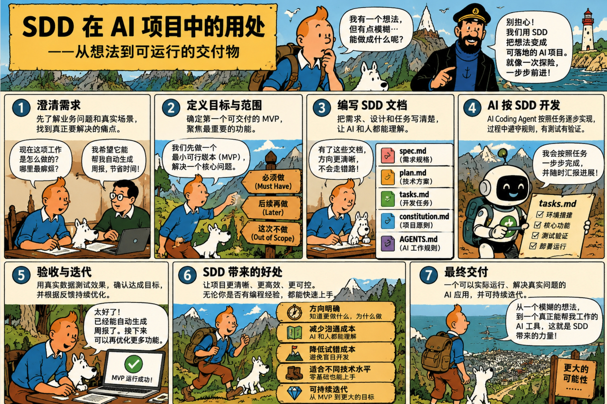

# AI 星火计划 · SDD 项目孵化导师

**让业务人员也能从一个模糊的想法，走到可以动手开发的 MVP。**

这是一个遵循 [Agent Skills 开放规范](https://agentskills.io/specification) 的可复用 Skill，可安装在支持 Agent Skills 的 AI Coding Agent 中。它会像一位 FDE 导师，先用少量问题梳理业务，再生成首次开发所需的 SDD（Spec-Driven Development，规格驱动开发）文档。

**适用对象：** 零编程基础的业务同事、使用 AI 开发工具的初学者、有软件开发经验的技术人员，以及负责指导项目的 AI 星火计划导师。

**快速开始：** [了解 SDD](#什么是-sdd) · [安装 Skill](#安装) · [启动示例](#怎么启动)

## 什么是 SDD

**SDD（Spec-Driven Development，规格驱动开发）** 是一种用明确的需求规格指导设计、开发、测试和迭代的工作方式。先说明要解决的业务问题、输入输出、第一版范围，以及怎样判断结果正确，再据此制定方案并拆解任务。需求变化时，同步维护规格、方案、任务和验收用例。

你可以把 SDD 理解为项目的“施工图＋验收单”。在 AI 辅助开发中，它让参与者和 AI 使用同一份项目依据：减少需求猜测，控制第一版范围，保留可以继续读取的项目上下文，并按明确标准检查交付结果。

### 一张图看懂：从想法到交付

[](docs/images/sdd-in-ai-projects.jpg)

点击图片可查看原尺寸。图示展示完整项目过程；图中提到的数据测试，应优先使用模拟或已获授权的脱敏样本。是否部署、部署到哪里，按实际项目要求确定。

### 五份文件分别做什么？

下面是本 Skill 采用的轻量文档约定，可根据项目规模和使用的工具调整。

| 文件 | 回答的问题 | 主要内容 |
| --- | --- | --- |
| `spec.md` | 做什么，怎样算做对？ | 业务需求、输入输出、MVP 范围、业务规则与验收标准 |
| `plan.md` | 用什么方法实现？ | 技术方案、模块与数据流程、关键取舍及验证方法 |
| `tasks.md` | 先做哪一步，每步怎样完成？ | 可执行任务、关联需求、依赖顺序与完成条件 |
| `constitution.md` | 项目遵守哪些原则？ | 简单可维护、数据保护、规格可追踪等项目原则 |
| `AGENTS.md` | Coding Agent 怎样在项目中工作？ | 阅读规格的顺序、修改范围、运行检查和汇报规则 |

例如，“想让 AI 自动生成周报”可以先收敛为：**第一版只读取一种固定格式的 Excel，按项目汇总进展与风险，输出约定格式的 Markdown 周报；缺少必填列时明确提示，使用模拟样本对照预期内容验收。** 随后把读取、校验、汇总、导出和验收拆成可以逐项完成的任务。

### 这个 Skill 在其中负责什么？

`ai-spark-sdd` 是这套工作方式的入门向导，默认负责**澄清业务需求 → 确定 MVP → 生成五份文档 → 检查是否具备开工条件**，并给出第一条开发任务和启动指令。参与者确认方向后，再由 Coding Agent 在业务项目中逐项实现、运行和验证。

图中的开发、部署与最终验收需要在后续项目工作中继续完成。应用是否可用，以实际运行、测试结果和业务人员的验收为依据；规格也应随项目反馈持续更新。

## 能做到什么？

- **少量问题**：第一轮最多 4 问，必要时第二轮最多追问 3 问；已有信息不重复问。
- **贴近业务**：先弄清使用者、现有流程、瓶颈、输入输出、成功标准。
- **自适应教学**：技术选择和解释深度根据参与者的实际经验调整。
- **MVP 优先**：选出一个完整的业务闭环，而不是一次性规划完整平台。
- **SDD 交付**：生成 `AGENTS.md`、`constitution.md`、`spec.md`、`plan.md`、`tasks.md`。
- **可开始开发**：输出第一条任务、验收标准与可复制的 Coding Agent 启动指令。

本仓库提供的是**流程化指导 Skill**，不是自动写完任何业务应用的脚本。输出的质量依赖参与者提供的真实场景与样本。

## 典型使用过程

```text
业务想法
  ↓
Discovery：首轮最多 4 问
  ↓
Clarification：必要时最多追问 3 问
  ↓
MVP 方案卡（用户可纠正）
  ↓
生成五份 SDD 文件
  ↓
开发就绪检查（Ready / Conditionally Ready / Blocked）
  ↓
从第一条任务启动 AI 辅助开发
```

## 仓库结构

```text
ai-spark-sdd-skill/
├── .gitignore
├── README.md
├── LICENSE
├── docs/
│   └── images/
│       └── sdd-in-ai-projects.jpg   # SDD 在 AI 项目中的流程说明图
└── skills/
    └── ai-spark-sdd/
        ├── SKILL.md                   # Skill 入口：触发、工作流、行为约束
        ├── LICENSE                    # 单独复制 Skill 时一并保留许可
        ├── references/
        │   ├── discovery-guide.md     # 访谈提问与编程水平适配
        │   ├── sdd-workflow.md        # 文件职责与一致性映射
        │   └── readiness-check.md     # 开发就绪质量门禁
        ├── assets/
        │   └── templates/
        │       ├── AGENTS.md
        │       ├── constitution.md
        │       ├── spec.md
        │       ├── plan.md
        │       └── tasks.md
        └── examples/
            └── expense-summary.md     # 财务 Excel 汇总项目示例
```

## 安装

公开仓库：[GeekerDing/ai-spark-sdd-skill](https://github.com/GeekerDing/ai-spark-sdd-skill)。可以直接克隆，或在仓库页面选择 **Code → Download ZIP** 后解压。

安装时请复制完整的 `skills/ai-spark-sdd/` 文件夹，保留其中的 `references/`、`assets/`、`examples/` 和 `LICENSE`，不要只复制 `SKILL.md`。以下命令会在目标目录已存在时停止；如需更新，请先检查并备份已有版本。

### Codex：使用 Skill Installer

在支持 `$skill-installer` 的 Codex 中输入：

```text
$skill-installer 从 GitHub 仓库 GeekerDing/ai-spark-sdd-skill 的 skills/ai-spark-sdd 目录安装 ai-spark-sdd。
```

### Codex：全局使用（macOS / Linux）

```bash
git clone https://github.com/GeekerDing/ai-spark-sdd-skill.git &&
mkdir -p ~/.agents/skills &&
mkdir ~/.agents/skills/ai-spark-sdd &&
cp -R ai-spark-sdd-skill/skills/ai-spark-sdd/. ~/.agents/skills/ai-spark-sdd/
```

Codex 会自动发现新安装的 Skill。开启新会话后如仍未识别，请重启 Codex。安装目录依据 [Codex 官方文档](https://learn.chatgpt.com/docs/build-skills)。

### Codex：仅在当前项目中使用

在业务项目根目录运行，将 `/path/to/ai-spark-sdd-skill` 替换为已下载仓库的本地路径：

```bash
mkdir -p .agents/skills &&
mkdir .agents/skills/ai-spark-sdd &&
cp -R /path/to/ai-spark-sdd-skill/skills/ai-spark-sdd/. .agents/skills/ai-spark-sdd/
```

### Claude Code：全局使用（macOS / Linux）

将 `/path/to/ai-spark-sdd-skill` 替换为已下载仓库的本地路径：

```bash
mkdir -p ~/.claude/skills &&
mkdir ~/.claude/skills/ai-spark-sdd &&
cp -R /path/to/ai-spark-sdd-skill/skills/ai-spark-sdd/. ~/.claude/skills/ai-spark-sdd/
```

如果只在某个项目使用，则放在项目的 `.claude/skills/ai-spark-sdd/` 目录下。目录依据 [Claude Code 官方文档](https://code.claude.com/docs/en/skills)。

**Windows 用户：** 无需执行上述 shell 命令，可直接将 `skills/ai-spark-sdd/` 文件夹复制到对应用户目录下的 `.agents/skills/`（Codex）或 `.claude/skills/`（Claude Code）。

**其他 AI 工具：** 如果支持 Agent Skills，可尝试按其官方说明安装；如果不支持，可以直接复制 `SKILL.md` 指令并提供 `references/` 和 `assets/` 文件供其阅读。不能保证所有聊天产品仅凭 GitHub URL 就会自动安装 Skill。

## 怎么启动？

安装后，开启一个新的会话并输入：

> 使用 ai-spark-sdd Skill 帮我把一个工作想法转化为第一版 MVP 和 SDD。我是第一次做软件项目，请先问我必要的问题。

也可以直接描述：

> 我想做一个可以读取项目 Excel、自动整理出技术方案的工具。先帮我澄清需求，不要直接写代码。

### 参与者应准备什么？

不用提前懂编程。最好能提供：

1. 一个最近遇到的真实工作问题。
2. 目前工作的简单描述。
3. 一个脱敏或模拟的输入样本，以及理想的输出示例（暂时没有也可以）。

**不要上传未经授权的客户、财务、员工或其他敏感数据。**

## SDD 会生成到哪里？

在参与者的**业务项目目录**中，而不是本 Skill 仓库中：

```text
<business-project>/
├── AGENTS.md
└── docs/sdd/
    ├── constitution.md
    ├── spec.md
    ├── plan.md
    └── tasks.md
```

如果 AI 工具没有文件写入权限，就输出可复制的 Markdown 内容。

这套结构独立于 GitHub Spec Kit。你可以单独使用本 Skill；如果后续采用 Spec Kit，可再依据其规定迁移或协调现有文档，不要将两套工具的目录误认为完全相同。

## 给导师的建议：第一次验收只看三样

| 交付物 | 最低要求 |
| --- | --- |
| SDD v0.1 | 核心问题、MVP 范围、需求与验收明确，计划与任务一致 |
| MVP v0.1 | 至少一个从输入到可检查输出的业务闭环能够实际运行 |
| Demo | 使用脱敏或模拟样本演示一次完整流程，并清楚指出未完成事项 |

推荐要求参与者先把 SDD 交给导师确认，再让 Coding Agent 逐项实现。导师重点审查业务价值、范围和可验证性，而不是逐行检查代码。

## 分享与二次发布

1. 将 [公开仓库首页](https://github.com/GeekerDing/ai-spark-sdd-skill) 分享给参与者，并让他们参照本 README 安装。
2. 已本地安装的副本不会自动同步仓库更新；更新前请先备份本地修改，再从仓库同步完整 Skill 文件夹。
3. 如需发布自己的版本，可以 Fork 本仓库，或新建仓库并上传完整文件，保留 `skills/ai-spark-sdd/SKILL.md` 的目录层级和 MIT 许可文本。
4. 若自己的版本使用 Private 仓库，需要为接收者提供访问权限；私有仓库链接不能供所有人直接访问。

GitHub 新建仓库入口：<https://github.com/new>

## 参考资料与标准

- [Agent Skills specification](https://agentskills.io/specification)
- [Codex Skills 文档](https://learn.chatgpt.com/docs/build-skills)
- [GitHub Spec Kit：SDD 工作方式](https://github.com/github/spec-kit#spec-driven-development)

## 许可

MIT License。允许复制、修改与分享；请保留许可文本。
